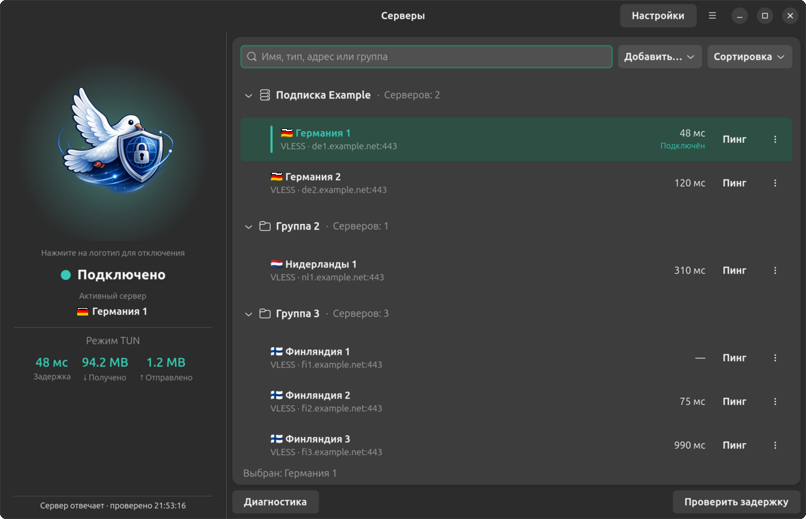
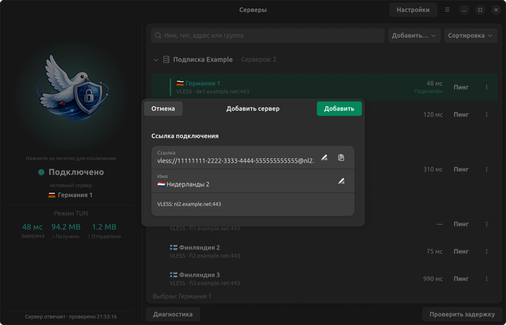
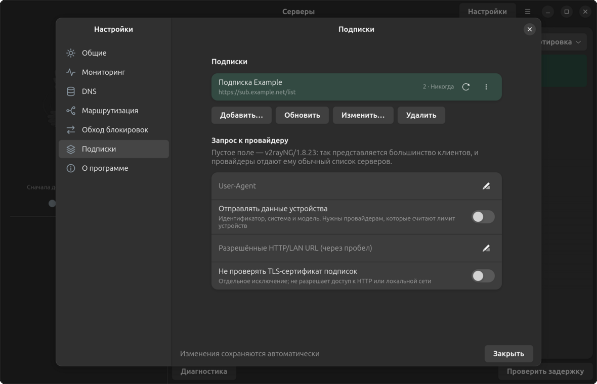
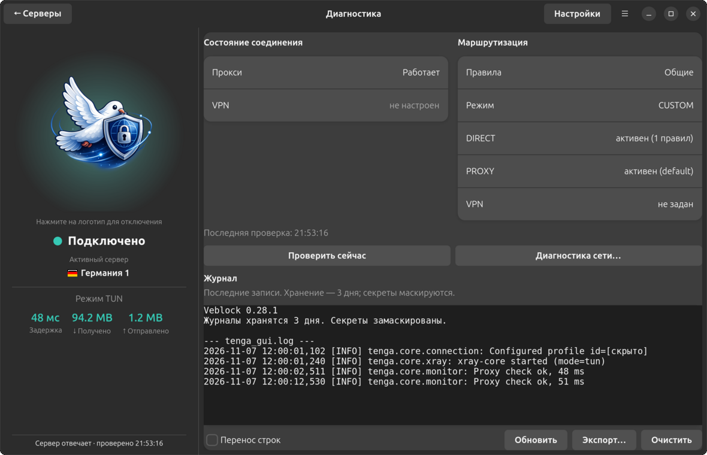

<div align="center">


# Veblock

Veblock (раньше Tenga Proxy) — прокси-клиент для Linux и Windows
на базе [xray-core](https://github.com/XTLS/Xray-core).

[Скачать](https://github.com/vebulogmetra/tenga-proxy/releases) ·
[Установка](docs/ru/installation.md) · [Документация](docs/ru/overview.md)

</div>



## Что это

Приложение для подключения к прокси-серверам. Понимает ссылки вида
`vless://`, `trojan://`, `vmess://`, `ss://` и подписки, умеет пускать через
прокси весь трафик системы или только выбранные сайты.

На Linux интерфейс написан на GTK 4 и libadwaita, на Windows — на Qt (PySide6).
В Windows-интерфейсе приложение называется **Monoliten**; репозиторий и установщик
сохраняют имя Veblock. Компоновка общая: слева состояние подключения, справа серверы
и диагностика. На Linux логотип — голубь со щитом, на Windows — монолит.
В настройках доступны системная, светлая и тёмная темы; в Qt по умолчанию тёмная.

Для подключения нужен свой сервер или подписка от провайдера прокси.

## Возможности

- **Протоколы:** VLESS (включая Reality и XTLS), Trojan, VMess,
  Shadowsocks (включая методы 2022), Hysteria2, SOCKS, HTTP
- **Транспорты и маскировка** — XHTTP, WebSocket, gRPC, HTTPUpgrade,
  настраиваемая фрагментация TLS
- **Подписки** — импорт и обновление списков серверов, повторный импорт
  в существующую группу, ссылки `veblock://` и `wingeon://`
- **Два режима работы** — TUN (весь трафик системы, как у VPN) или
  системный прокси (GNOME/KDE и Windows настраиваются автоматически)
- **Гибкая маршрутизация** — отдельные правила для доменов и подсетей:
  напрямую, через прокси или через VPN
- **Пакетный замер задержки** — проверка серверов и сортировка по пингу
- **Автопереключение** — переход на другой сервер той же группы после
  заданного числа неудачных проверок
- **Выбор DNS** — Google, Cloudflare, AdGuard или свой сервер; запросы
  можно пускать через прокси
- **Системный трей** — подключение и смена сервера без открытия окна
- **Диагностика** — состояние соединения, VPN и активных правил
- **Диагностика сети** — проверка вручную: белые списки, доступ к Telegram, Instagram и
  YouTube, DNS; итог можно скопировать, отчёт без адресов — сохранить в файл
- **Обновления** — уведомления о новых версиях; в установленной Windows-сборке
  доступны загрузка и запуск обновления с проверкой размера и SHA-256

## Установка

### Linux

Скачайте `tenga-proxy_<версия>_amd64.deb` со страницы
[Releases](https://github.com/vebulogmetra/tenga-proxy/releases) и установите:

```bash
sudo apt install ./tenga-proxy_<версия>_amd64.deb
```

Зависимости (Python, GTK 4, libadwaita 1.5+) apt поставит сам. Подходят
Ubuntu 24.04, Debian 13 и новее. Пакет сам выдаёт и права для режима TUN:
`cap_net_admin` ядру и sudo без пароля на помощник маршрутов для группы `sudo`.

AppImage больше не выпускается. Как перейти с неё и что где лежит — в
[документации](docs/ru/installation.md).

### Windows

Скачайте `veblock-<версия>-windows-x64-setup.exe` со страницы
[Releases](https://github.com/vebulogmetra/tenga-proxy/releases) и запустите.
Нужны Windows 10 или 11 (x64) и права администратора на время установки.
Qt, xray-core и драйвер wintun входят в установщик.

Установщик регистрирует службу «Veblock»: через неё работает режим TUN,
поэтому при подключении запрос UAC не появляется. Подробнее — в
[документации по установке](docs/ru/installation.md#windows).

### Обновление приложения

О новой версии приложение сообщит уведомлением. В установленной Windows-сборке
обновление можно скачать и запустить из интерфейса: после подтверждения приложение
проверит файл, отключит соединение и запустит установщик с запросом UAC.
После установки приложение перезапустится.

На Linux новую версию устанавливают deb-пакетом. Из исходников самообновление
Windows-установщиком недоступно.

## Как пользоваться

### Добавить сервер

Нажмите **Добавить… → Сервер по ссылке…** над списком и вставьте ссылку
подключения. Приложение разберёт её само: имя, адрес и протокол заполнятся
автоматически.



Если у вас есть ссылка на подписку, выберите **Добавить… → Подписка…** —
список серверов загрузится целиком. Подписки собраны в **Настройки →
Подписки**: там их можно обновить, изменить или удалить.



### Подключиться

Выберите сервер в списке и нажмите на логотип в панели слева. Двойной клик по
строке подключает сразу. Пока соединение работает, выделение другой строки его
не меняет: для смены сервера нажмите **Переключить на выбранный** под списком.

Задержка до сервера видна справа в строке. Чтобы измерить её у всех сразу,
нажмите **Проверить задержку** или `Ctrl+T`.

Пинг помогает сравнить задержку, но не измеряет скорость загрузки и не подтверждает
работу всех правил, DNS и TUN. Состояние текущего подключения показывает диагностика.

В **Настройках → Мониторинг → Автопереключение** можно включить переход
на другой сервер группы при отказе текущего и задать порог неудачных проверок.

### Проверить состояние

Кнопка **Диагностика** под списком показывает, работает ли прокси, поднят ли
VPN, какие правила маршрутизации сейчас действуют, и журнал.



Кнопка **Диагностика сети…** там же, одноимённый пункт главного меню или `Ctrl+D` открывают
проверку сети. Она запускается только вручную и идёт до 3 минут, до 8 МиБ данных плюс
служебный трафик. Запросы идут напрямую, настройки не меняются. Если включена блокировка
трафика, прямые запросы не выполняются, и окно это объясняет.

### Работать из трея

Значок трея показывает состояние подключения: на Linux это кольцо,
на Windows — монолит. Через меню можно сменить сервер или отключиться,
не открывая окно.

В GNOME для значков в трее нужно расширение
[AppIndicator and KStatusNotifierItem Support](https://extensions.gnome.org/extension/615/appindicator-support/).
Без него приложение работает как обычно, просто без иконки в панели.

## Сочетания клавиш

| Сочетание | Действие |
|-----------|----------|
| `Ctrl+Return` | Подключить или отключить |
| `Ctrl+T` | Проверить задержку |
| `Ctrl+D` | Диагностика сети |
| `Ctrl+N` | Добавить сервер |
| `Ctrl+Shift+N` | Добавить подписку |
| `F5` | Обновить подписки |
| `Ctrl+F` | Поиск по списку |
| `Ctrl+,` | Настройки |
| `Ctrl+W` | Скрыть окно |
| `Ctrl+Q` | Выход |

## Режимы работы

**TUN** (по умолчанию) — приложение поднимает виртуальный сетевой интерфейс
и направляет системный трафик по настроенным правилам, включая трафик программ,
которые не умеют работать с прокси. Правила могут отправлять отдельные адреса напрямую.

**Системный прокси** — приложение поднимает локальный SOCKS и HTTP прокси и
прописывает его в настройки рабочего стола. Трафик пойдёт только у программ,
которые эти настройки читают.

Режим переключается в **Настройках → Общие**.

## Командная строка

У проекта есть и консольный интерфейс — он пригодится на сервере без
графики или в скриптах. Работает при запуске из исходников:

```bash
# Добавить сервер и посмотреть список
uv run python cli.py add "vless://..."
uv run python cli.py ls

# Запустить в режиме системного прокси по номеру из списка
uv run python cli.py run 1 --mode system-proxy

# Проверить, что трафик идёт через прокси
curl --proxy socks5h://127.0.0.1:2080 https://ifconfig.me

# Справка
uv run python cli.py --help
```

Полный список команд — в [документации](docs/ru/cli.md).

## Документация

- [Обзор возможностей](docs/ru/overview.md)
- [Установка](docs/ru/installation.md)
- [Графический интерфейс](docs/ru/gui.md)
- [Серверы и подписки](docs/ru/profiles.md)
- [Протоколы](docs/ru/protocols.md)
- [Маршрутизация](docs/ru/routing.md)
- [VPN](docs/ru/vpn.md)
- [Командная строка](docs/ru/cli.md)

Аналитические материалы на 9 ноября 2026 года:

- [Hiddify: изменения между 2.0.5 и 5.5.5](docs/ru/hiddify-2.0.5-vs-5.5.5.md)
- [Hiddify 5.5.5 и Veblock: возможности и приоритеты](docs/ru/hiddify-5.5.5-vs-veblock.md)

## Разработка

Нужны Python 3.11+ и `uv`; на Windows используется Python 3.12 и Git Bash.
Для GTK на Linux также нужны системные библиотеки PyGObject и Pycairo.

Подготовка окружения и ядра из корня репозитория:

```bash
bash core/scripts/install_dev.sh
uv run python gui.py
```

Скрипт подготавливает зависимости для текущей ОС. Подробности, требования к Linux
и команды сборки — в [руководстве разработчика](docs/ru/development.md).

Для проверок на Linux установите зависимости разработки: `uv sync --extra dev`.
На Windows используйте `uv sync --extra windows --extra dev`.
Основные проверки:

```bash
uv run pytest
uv run python cli.py lint
uv run ruff format --check .
```

GTK, D-Bus и TUN проверяются в Linux. Для Windows и Qt используются отдельные
наборы тестов; полный pytest на Windows включает Linux-зависимые проверки.

## Лицензия

[MIT](LICENSE)
