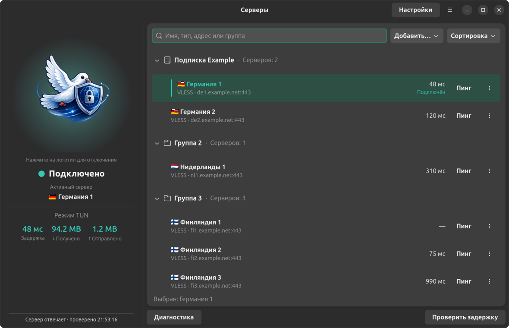
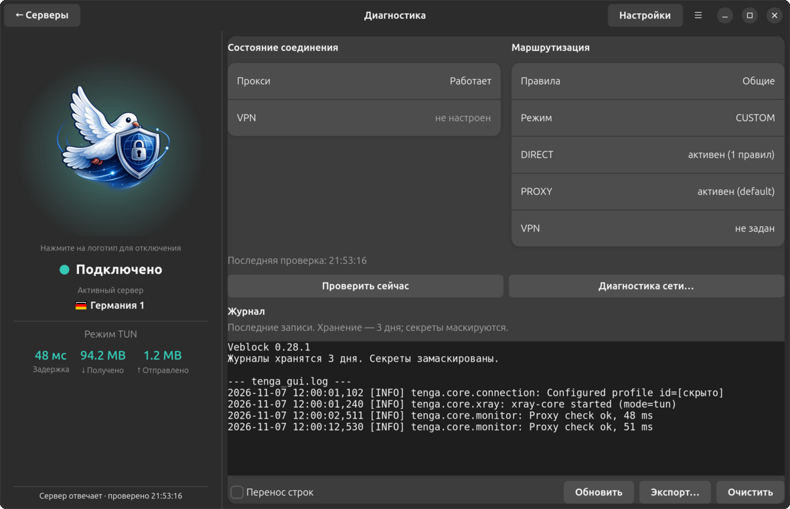
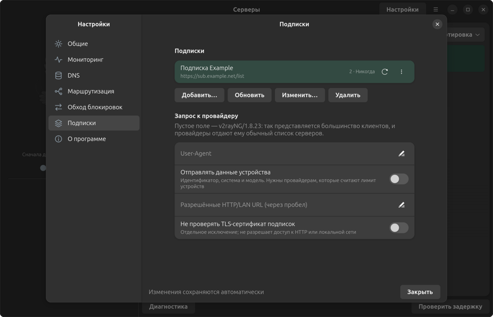

# GUI

Veblock's graphical interface provides convenient management of proxy connections through the system tray and main application window.

## Running GUI

```bash
python gui.py
```

## Main Window

The window is the same on Linux (GTK) and Windows (Qt) except for the logo:
a dove on Linux, a monolith on Windows.



The status panel always stays on the left: the logo, the session state, the
active server, the mode, latency and traffic, and the result of the last check
at the bottom. Click the logo to connect or disconnect; it is disabled during an
operation. The glow under the logo is teal while a session runs, orange during an
operation and red on an error. "Connected" alone does not mean the server
answers: the check line reports that.

The right side holds the servers: search, "Add…" (server from a link, from the
clipboard, subscription, group), "Sort" and the groups. Each row shows the name,
type, address and latency, a "Ping" button and an actions menu. The active server
has a teal marker and a "Connected" label. Selecting another row does not change
the connection: use "Switch to selected" below the list. Enter and double-click
connect right away. "Test latency" at the bottom measures all servers.

### Diagnostics

The "Diagnostics" button below the list replaces the right side with the
connection and VPN state, the active routing rules and the log; "← Servers" in
the header bar brings the list back with the same query, selection and scroll
position.



"Check now" and "Network diagnostics…" (a separate manual network check) are
there too.

The proxy status is not "the core process is running" but the result of a
request through the server itself: the application reaches the test URL via
a service inbound of the core on `127.0.0.1`, protected by a one-time password.
Routing rules do not apply to this request, so "server does not respond" means
the server itself, even when the test URL is on your direct list.

### Failover

Settings → Monitoring has an automatic failover switch (off by default). After
the configured number of failed checks in a row the application connects
another server of the same group — the one with the lowest measured latency
first — and tells you with a notification. It does not return to a server that
has just stopped responding for 15 minutes. When no suitable server is left
the connection is kept: traffic must not suddenly go direct.

### Core updates

Settings → About shows the xray core version and a "core update" row. Every
three days, and on the "Check" button, the application asks GitHub for the
release list and tells you when a newer version is out. It never downloads or
replaces the core itself.

## System Tray

The icon shows the connection state with three distinct glyphs: a crossed-out
circle when disconnected, a dashed ring while connecting, and a filled circle
when connected.

The tray uses `StatusNotifierItem`. GNOME needs an extension that displays such
items (AppIndicator/Tray Icons, for example); without one the application runs
as usual, just without a panel icon. Pass `--no-tray` to disable the icon.

The system tray icon allows you to:

- Quickly connect/disconnect from the current server
- Select a server to connect to
- Add new servers
- Open the main application window
- Open settings
- Exit the application

## Application Settings

In settings you can:

- Configure proxy port
- Block traffic on connection loss (TUN mode on Linux only, see [routing](routing.md))
- Configure DNS servers
- Configure routing parameters
- Configure monitoring parameters
- Configure VPN integration parameters

## Keyboard Shortcuts

| Shortcut | Action |
|----------|--------|
| `Ctrl+Return` | Connect or disconnect |
| `Ctrl+T` | Test latency |
| `Ctrl+N` | Add server |
| `Ctrl+Shift+N` | Add subscription |
| `F5` | Refresh subscriptions |
| `Ctrl+F` | Search |
| `Ctrl+,` | Settings |
| `Ctrl+W` | Hide window |
| `Ctrl+Q` | Quit |

The full list is available from the "☰" menu → "Keyboard Shortcuts".

## Appearance

On Linux the interface follows the GNOME HIG and uses the system theme by
default; Settings → General lets you pick system, light or dark.

The window does not shrink below 900×540. When it is lower than 680 points the
status panel becomes compact: a smaller logo and captions, with all the data
still in place.

## Settings Window

Settings open in a separate window with seven sections: General, Monitoring,
DNS, Routing, Censorship bypass, Subscriptions and About. Changes are saved
automatically; the footer tells whether a change is pending, written, or needs a
reconnect. Invalid values are not written. In system proxy mode the TUN fields
are hidden, and their values are kept for when you return to TUN.

Subscriptions live in the Subscriptions section: "Add…", "Update", "Edit…" and
"Delete" act on the selected subscription. Forms opened from there appear on
top of the settings.



General → Window has "Minimize to tray when the window is closed": while the
tray icon is visible, closing the window only hides it; otherwise it quits.

Qt window on Windows: [main window](../design/windows-ui/main-dark-1180.png) ·
[diagnostics](../design/windows-ui/diagnostics.png) ·
[settings](../design/windows-ui/settings.png). All screenshots use synthetic data.
