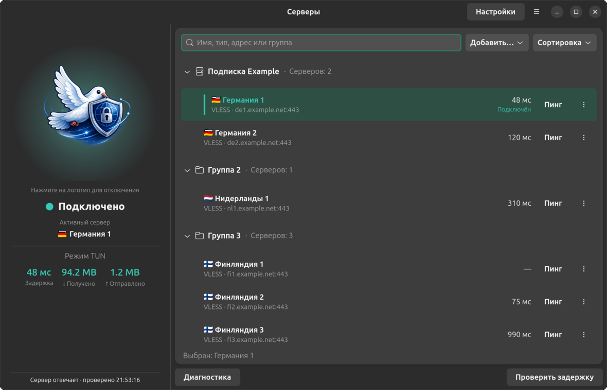
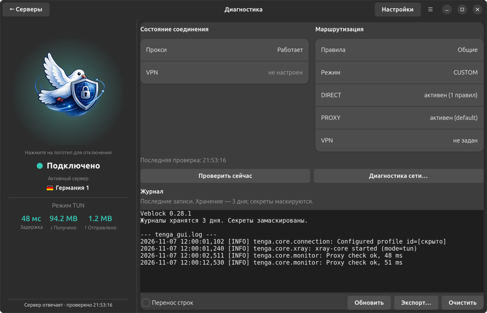
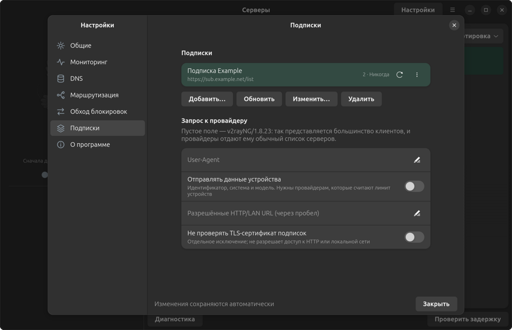

# GUI

Графический интерфейс Veblock предоставляет удобное управление прокси-соединениями через системный трей и главное окно приложения.

## Запуск GUI

```bash
python gui.py
```

## Главное окно

Окно одинаково на Linux (GTK) и Windows (Qt), кроме логотипа: на Linux это
голубь, на Windows — монолит.



Слева всегда видна панель состояния: логотип, состояние сессии, активный
сервер, режим, задержка и трафик, внизу — результат последней проверки.
Нажмите на логотип, чтобы подключиться или отключиться; во время операции он
недоступен. Свечение под логотипом бирюзовое при запущенной сессии, оранжевое
во время операции и красное при ошибке. «Подключено» само по себе не значит,
что сервер отвечает: это показывает строка проверки.

Справа — серверы: поиск, «Добавить…» (сервер по ссылке, из буфера обмена,
подписка, группа), «Сортировка» и группы. Каждая строка показывает имя, тип,
адрес и задержку, кнопку «Пинг» и меню действий. Активный сервер отмечен
бирюзовым маркером и подписью «Подключён». Выделение другой строки не меняет
соединение: для смены сервера нажмите «Переключить на выбранный» под списком.
Enter и двойной щелчок по строке подключают сразу. «Проверить задержку» внизу
измеряет все серверы.

### Диагностика

Кнопка «Диагностика» под списком открывает в правой части состояние соединения
и VPN, действующие правила маршрутизации и журнал; «← Серверы» в шапке
возвращает список с прежним запросом, выделением и прокруткой.



Здесь же «Проверить сейчас» и «Диагностика сети…» — отдельная ручная проверка
сети.

Статус прокси — это не «процесс ядра запущен», а результат запроса через
сам сервер: приложение обращается к проверочному адресу через служебный
вход ядра на `127.0.0.1`, закрытый одноразовым паролем. Правила маршрутизации
на этот запрос не действуют, поэтому «Сервер не отвечает» означает именно
сервер, даже если проверочный адрес у вас в списке «напрямую».

### Автопереключение

В «Настройки» → «Мониторинг» можно включить автопереключение (по умолчанию
выключено). После заданного числа неудачных проверок подряд приложение
подключает другой сервер той же группы — сначала с наименьшей измеренной
задержкой — и сообщает об этом уведомлением. К серверу, который только что
перестал отвечать, оно не возвращается 15 минут. Если подходящих серверов не
осталось, подключение не разрывается: трафик не должен внезапно пойти напрямую.

### Обновление ядра

«Настройки» → «О программе» показывает версию ядра xray и строку «Обновление
ядра». Раз в три дня и по кнопке «Проверить» приложение спрашивает у GitHub
список релизов и сообщает, если вышла версия новее. Само ядро приложение не
скачивает и не заменяет.

## Системный трей

Иконка показывает состояние соединения тремя разными значками: перечёркнутый
круг — отключено, пунктирное кольцо — идёт подключение, залитый круг —
подключено.

Трей работает через `StatusNotifierItem`. В GNOME для этого нужно расширение,
показывающее такие значки (например, AppIndicator/Tray Icons); без него
приложение работает обычным образом, просто без иконки в панели. Отключить
иконку можно запуском с `--no-tray`.

Иконка в системном трее позволяет:

- Быстро подключаться/отключаться от текущего сервера
- Выбирать сервер для подключения
- Добавлять новые серверы
- Открывать главное окно приложения
- Открывать настройки
- Выходить из приложения

## Настройки приложения

В настройках можно:

- Выбрать режим работы: `Системный прокси` или `TUN`
- Настроить порт прокси (для режима системного прокси)
- Настроить параметры TUN (имя интерфейса и MTU)
- Включить блокировку трафика при обрыве (только TUN на Linux, см. [маршрутизацию](routing.md))
- Настроить DNS-серверы
- Настроить общие правила маршрутизации на странице «Маршрутизация» (у сервера
  могут быть свои, см. [маршрутизацию](routing.md#настройка-в-gui))
- Настроить параметры мониторинга
- Настроить параметры VPN-интеграции

## Режим TUN

В режиме `TUN` (теперь режим по умолчанию) приложение запускает `xray-core` с inbound типа `tun` и не изменяет системные
настройки прокси (GNOME/KDE). Для успешного запуска требуются права на создание TUN-интерфейса
(`CAP_NET_ADMIN` или запуск от `root`).

## Сочетания клавиш

| Сочетание | Действие |
|-----------|----------|
| `Ctrl+Return` | Подключить или отключить |
| `Ctrl+T` | Проверить задержку |
| `Ctrl+N` | Добавить сервер |
| `Ctrl+Shift+N` | Добавить подписку |
| `F5` | Обновить подписки |
| `Ctrl+F` | Поиск |
| `Ctrl+,` | Настройки |
| `Ctrl+W` | Скрыть окно |
| `Ctrl+Q` | Выход |

Полный список доступен в меню «☰» → «Сочетания клавиш».

## Внешний вид

Интерфейс на Linux следует GNOME HIG и по умолчанию использует системную тему.

Окно не сжимается меньше 900×540. Когда высота меньше 680 точек, панель
состояния становится компактной: логотип и подписи меньше, а все данные на
месте. Тему — системную, светлую или тёмную — можно выбрать в «Настройки» →
«Общие».

### Сохранение и применение настроек

Валидные изменения сохраняются автоматически после паузы во вводе; закрытие формы
завершает отложенное сохранение. Неверный ввод отмечается в поле и не заменяет
последнюю валидную конфигурацию. Ошибка записи показывается уведомлением.
Настройки записываются через временный файл с атомарной заменой.

Тема применяется сразу. Мониторинг можно перенастроить без перезапуска ядра.
Изменения DNS, маршрутизации, транспорта, режима, портов, уровня журналирования
и геобаз требуют переподключения: окно показывает плашку и кнопку. Возврат к
применённым значениям убирает плашку. Переподключение выполняет остановку и запуск
через общую очередь операций соединения.

На странице мониторинга доступен обновляемый журнал, экспорт очищенного текста
и очистка с подтверждением. Чтение выполняется вне GTK-потока, ограничено объёмом
и количеством файлов. При просмотре старых файлов секреты маскируются повторно;
current_config.json и файлы серверов в экспорт не входят. Очистка сохраняет запись
в активный журнал. Срок хранения — три дня.

В «О программе» можно проверить обновление приложения и открыть официальный релиз.
Фоновая проверка выполняется не чаще раза в сутки, без идентификаторов устройства.
Предварительные версии и автоматические проверки приложения/ядра управляются
отдельными переключателями. Проверка ядра сохраняет интервал три дня.

Примеры интерфейса на синтетических данных, без настоящего подключения:

- [Плашка переподключения](../screenshots/2026-10-20-profiles.png).
- [Настройки DNS](../screenshots/2026-10-20-settings.png).
- [Журнал](../screenshots/2026-10-20-monitoring.png).

## Окно настроек

Настройки открываются отдельным окном с семью разделами: «Общие»,
«Мониторинг», «DNS», «Маршрутизация», «Обход блокировок», «Подписки» и
«О программе». Строка внизу сообщает, ждёт ли изменение записи, записано ли оно
и нужно ли переподключение. В режиме системного прокси параметры TUN скрыты, а
при возврате к TUN их значения сохраняются.

Подписки живут в разделе «Подписки»: список, «Добавить…», «Обновить»,
«Изменить…» и «Удалить» действуют на выбранную подписку. Формы, открытые
отсюда, появляются поверх настроек.



В «Общие» → «Окно» есть переключатель «Сворачивать в трей при закрытии окна»: пока
иконка в трее видна, закрытие окна только прячет его, иначе закрывает
приложение.

Снимки Qt-окна на Windows: [главное окно](../design/windows-ui/main-dark-1180.png) ·
[диагностика](../design/windows-ui/diagnostics.png) ·
[настройки](../design/windows-ui/settings.png). Все снимки содержат синтетические
данные.
